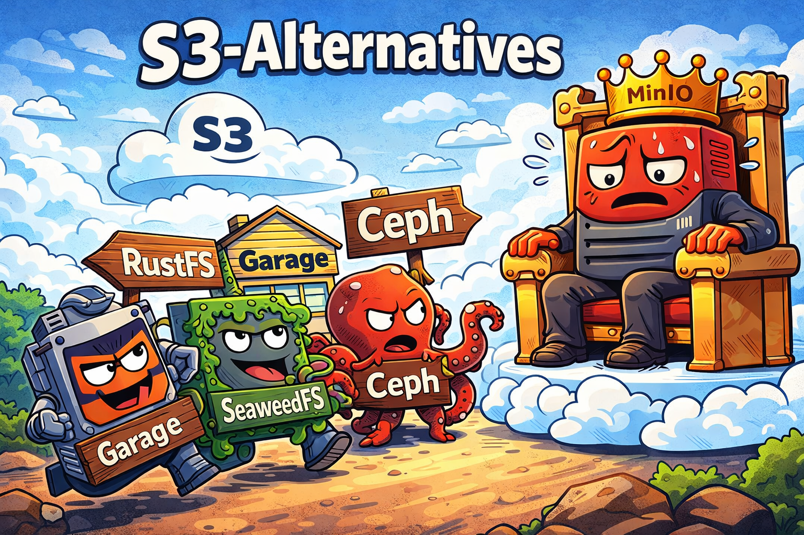
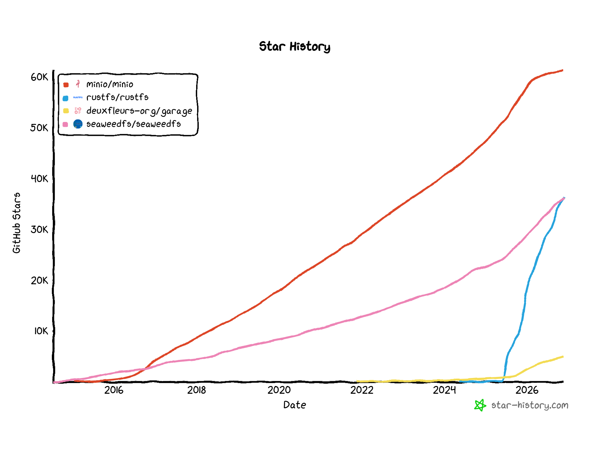

# S3-Alternatives

> **Last updated:** November 2026. Stars, prices and versions change quickly. Corrections and PRs are welcome.

For a long time, **MinIO** was the undisputed king of open-source S3 storage. Then the community edition was stripped down step by step, put into maintenance mode and finally **archived on 13 February 2026**. Development and security fixes now only happen in the commercial **MinIO AIStor**. Many developers and architects (myself included) have been searching for a worthy successor ever since.

Finding a replacement that balances performance, ease of use, security and a truly open ecosystem isn't as simple as it sounds. This repository is a curated collection of S3-compatible products, services and self-hosted solutions to help you find the right fit for your stack.

## TL;DR

| If you…                                                                    | Consider                                              |
| :------------------------------------------------------------------------- | :---------------------------------------------------- |
| run a small to medium self-hosted setup and value stability over features | **Garage**                                            |
| still run MinIO and need security patches today                            | **SILO** (community fork) or **AIStor** (paid)        |
| need erasure coding, a filer or very large scale                           | **SeaweedFS** or **Ceph**                             |
| want a permissive Apache-2.0 MinIO replacement and accept a young codebase | **RustFS ≥ 1.0**                                      |
| don't want to operate storage yourself                                     | a [hosted European provider](#-hosted-s3-in-europe)   |
| need a fake S3 for unit tests or CI                                        | **Adobe S3Mock**, **S3 ninja**                        |

## 🪦 What happened to MinIO?

- **2021:** Relicensed from Apache 2.0 to AGPL-3.0.
- **2025:** The admin console was removed from the community edition and the repository went into maintenance mode.
- **13 Feb 2026:** The `minio/minio` repository was archived. It is read-only: no releases, no bug fixes, no security patches.
- **Since then:** Several CVEs affecting the final community release (e.g. CVE-2026-34204, CVE-2026-39414) were fixed only in AIStor and remain unpatched upstream.

**Your options if you still run MinIO:** migrate to an alternative, switch to the [SILO](https://github.com/pgsty/silo) community fork (reads the same data directory and `MINIO_*` settings), buy AIStor, or buy third-party extended support (e.g. TuxCare ELS).

### MinIO AIStor tiers

| Tier            | Scope                                                                                                                       | Price      |
| :-------------- | :-------------------------------------------------------------------------------------------------------------------------- | :--------- |
| Free            | Single node only, **development and test only**, max. 10 TiB, no production or commercial use, MinIO may terminate any time | Free       |
| Enterprise Lite | Multi-node, HA, < 400 TiB (auto-upgrade to Enterprise above), self-support, optional support add-on (< 5 day SLA)          | On request |
| Enterprise      | Unlimited scale, 24/7 support, < 4 h SLA                                                                                    | On request |

> ⚠️ The December 2025 launch announcement described the Free tier as suitable for "production workloads where distributed high availability isn't required". The [current license agreement](https://www.min.io/legal/aistor-free-agreement) explicitly forbids production and commercial use. Read the agreement before you deploy.

AIStor is closed source, so its code and vulnerability history can no longer be reviewed independently.

## ⚠️ The Maintenance Reality

One crucial finding of this research is the **maintenance gap**. While MinIO was backed by a large corporation, many promising alternatives are "labor of love" projects.

- **The Bus Factor:** A significant number of S3 projects are maintained by a **single person** or a very small group of volunteers.
- **Corporate vs. Community:** Only a few have corporate backing (Ceph, Zenko/Scality, RustFS, Inc.). Others depend on volunteers or public grants. Garage, for example, is largely funded by EU NGI grants via NLnet. See [Funding & Backing](#-funding--backing).
- **Longevity & Vitality:** Before moving production data, check the "Key Committers" (bus factor) and the latest activity. A project started in 2011 shows maturity, but it needs regular updates to stay secure and compatible with modern S3 API standards.
- **Release Stage:** Check if the project has a stable v1.0.0 or "GA" (General Availability) release. RustFS reached **1.0 GA on 16 September 2026**, but some features (S3 Tables, MinIO on-disk compatibility) are still marked *Preview*. Alarik is still alpha/beta.
- **Security Track Record:** "Production-ready" and "battle-tested" are not the same. Look at the CVE history and at how quickly fixes ship. See [Security Track Record](#-security-track-record).

## Star History

## S3 Server (Storage Engines)

This table tracks the most promising successors and alternatives to MinIO, focusing on licensing, community health and maturity.

| Name                                                            | Lang    | License     | Owner                  | Status (Nov 2026)          | Docker Pulls | GH Stars | First Commit    | Key Committers  |
| :-------------------------------------------------------------- | :------ | :---------- | :--------------------- | :------------------------- | :----------- | :------- | :-------------- | :-------------- |
| **[MinIO AIStor](https://www.min.io)**                          | Go      | Proprietary | MinIO Inc              | Active (commercial)        | -            | -        | -               | -               |
| **[MinIO Community](https://github.com/minio/minio)**           | Go      | AGPL-3.0    | MinIO Inc              | ⛔ Archived Feb 2026       | -            | 49k+     | -               | -               |
| **[SILO](https://github.com/pgsty/silo)**                       | Go      | AGPL-3.0    | Pigsty                 | Active MinIO fork          | 10K+         | 2.9k+    | Dec 2025 (fork) | 1 (+ AI agents) |
| **[RustFS](https://github.com/rustfs/rustfs)**                  | Rust    | Apache 2.0  | RustFS, Inc.           | 1.0 GA (Sep 2026)          | 10M+ ¹       | 35k+     | Feb 2024        | ~4              |
| **[Garage](https://github.com/deuxfleurs-org/garage)**          | Rust    | AGPL-3.0    | Deuxfleurs             | Stable (v2.x)              | 1M+          | 4.8k+    | April 2020      | ~2              |
| **[SeaweedFS](https://github.com/seaweedfs/seaweedfs)**         | Go      | Apache 2.0  | Chris Lu (independent) | Stable (4.x)               | 10M+         | 36k+     | November 2011   | 1               |
| **[Ceph](https://github.com/ceph/ceph)**                        | C++     | LGPL-2.1/3  | Ceph Foundation        | Stable (20.x)              | -            | 6.3k+    | April 2001      | ~10             |
| **[Zenko CloudServer](https://github.com/scality/cloudserver)** | Node.js | Apache 2.0  | Scality                | Active                     | 5M+          | 1.9k+    | September 2015  | ~6              |
| **[Alarik](https://github.com/achtungsoftware/alarik)**         | Swift   | Apache 2.0  | Achtung Software       | Alpha / Beta               | 3K           | 550+     | 2025            | 1               |

¹ Vendor claim from the GA announcement.

### Notes

- **SILO:** Drop-in replacement for MinIO (same on-disk format, same `MINIO_*` variables, restored admin console). It has patched the post-archive CVEs. It has a single maintainer, and the project's scope has grown beyond the original "security fixes only" pledge.
- **RustFS:** The most visible MinIO challenger, with an Apache-2.0 license and MinIO-like operations. It had a long list of serious vulnerabilities during alpha/beta (see below). It has been GA only since September 2026, so its production track record is still short.
- **Garage:** Built for small to medium, geo-distributed self-hosting. It uses replication instead of erasure coding, so plan for more raw capacity. Deuxfleurs has run it in production since 2020. In May 2026, Unity's on-premises deployment replaced RustFS with Garage. The main repository lives at [git.deuxfleurs.fr](https://git.deuxfleurs.fr/Deuxfleurs/garage). GitHub is a mirror.
- **SeaweedFS:** Very feature-rich (filer, erasure coding, Iceberg tables) and scales well. Its S3 gateway had several cross-bucket vulnerabilities in 2026, so patch promptly.
- **Ceph:** Built for massive scale. Realistically it needs a dedicated storage team.
- **Alarik:** A new Swift-based engine, positioned as an alternative to MinIO and RustFS. It is not ready for production yet.

## S3 Proxy (Gateway to Filesystem)

| Name                                                            | License    | Owner                 | Docker Pulls | GH Stars | First Commit | Key Committers |
| :-------------------------------------------------------------- | :--------- | :-------------------- | :----------- | :------- | :----------- | :------------- |
| **[Versity S3 Gateway](https://github.com/versity/versitygw/)** | Apache 2.0 | Versity Software, Inc | 50K+         | 1.3k+    | May 2023     | ~4             |
| **[S3Proxy](https://github.com/gaul/s3proxy)**                  | Apache 2.0 | Andrew Gaul           | 5M+          | 2.2k+    | July 2014    | 1              |

## S3 Simulators

| Name                                                | License | Owner        | Docker Pulls | GH Stars | First Commit | Key Committers |
| :-------------------------------------------------- | :------ | :----------- | :----------- | :------- | :----------- | :------------- |
| **[S3 ninja](https://github.com/scireum/s3ninja)**  | MIT     | scireum GmbH | 1M+          | 500+     | August 2013  | 1              |
| **[Adobe S3Mock](https://github.com/adobe/S3Mock)** | Apache 2.0 | Adobe Inc | 10M          | 1.1k+    | July 2017    | ~2             |

## 🔐 Security Track Record

The lists below are not exhaustive. They show the *kind* of vulnerabilities each project has had. A short CVE list doesn't prove that a project is secure: smaller projects simply get less attention from security researchers.

### MinIO

- About 28 CVEs since 2018. Two of them are in CISA's *Known Exploited Vulnerabilities* catalog: **CVE-2023-28432** and **CVE-2023-28434** were used in real attacks in 2023, on clusters where patches had already been available for months.
- **CVE-2026-33322:** OIDC JWT algorithm confusion (CVSS 9.8). Under certain IdP configurations, anyone who knows the client secret could mint an admin token. Affected releases spanned **Nov 2022 to Mar 2026**.
- **CVE-2026-33419:** LDAP user enumeration with no rate limit on password guessing.
- **CVE-2026-41145:** Authentication bypass in the streaming upload path.
- After the archival, fixes reach only AIStor and SILO.

### RustFS (all fixed, all in pre-1.0 releases)

| CVE            | Issue                                                                       | Fixed in        |
| :------------- | :-------------------------------------------------------------------------- | :-------------- |
| CVE-2025-68926 | Hard-coded gRPC token, authentication bypass                                | 1.0.0-alpha.78  |
| CVE-2025-68705 | Path traversal in RPC file stream, arbitrary file read/write (critical)     | 1.0.0-alpha.79  |
| CVE-2026-22043 | IAM short-circuit, privilege escalation via service-account minting         | alpha           |
| CVE-2026-27607 | Missing POST policy validation, arbitrary object write                      | 1.0.0-alpha.83  |
| CVE-2026-27822 | Stored XSS in the console                                                   | 1.0.0-alpha.83  |
| CVE-2026-24762 | Credentials logged in plaintext                                             | alpha           |
| CVE-2026-21862 | SourceIp policy bypass via spoofed `X-Forwarded-For`                        | alpha           |
| CVE-2026-39360 | `UploadPartCopy` authorization bypass, cross-bucket exfiltration            | alpha.90        |
| CVE-2026-40937 | Notification admin endpoints check authentication but not authorization    | patched         |
| CVE-2026-62378 | Stored XSS in the console (CVSS 9.0), a **regression** of CVE-2026-27822    | Console 0.1.10  |

As of November 2026, no CVE affecting **≥ 1.0.0 GA** has been found. Watch the [security advisories](https://github.com/rustfs/rustfs/security/advisories).

### SeaweedFS (2026)

| CVE            | Issue                                                                     | Fixed in |
| :------------- | :------------------------------------------------------------------------ | :------- |
| CVE-2026-54917 | Path traversal in the S3 and Iceberg gateway routers                      | 4.30     |
| CVE-2026-58371 | Unvalidated JSONP callback, cross-origin information disclosure          | 4.30     |
| CVE-2026-55874 | `..` in `X-Amz-Copy-Source`, cross-bucket read                            | 4.34     |
| CVE-2026-58372 | Path traversal in `DeleteObjects`, cross-tenant deletion                  | 4.34     |
| CVE-2026-73080 | Server-side request forgery (SSRF)                                        | patched  |

### Garage

- No CVEs found in public vulnerability databases (as of November 2026).
- There is one open dependency advisory: an unmaintained `protobuf` crate pulled in via `opentelemetry-prometheus`.

### SILO

- Inherits MinIO's history. According to the project, it has patched 7 post-archive CVEs (including CVE-2026-33322) and added 18 further security hardenings. These numbers are self-reported and have not been independently reviewed.

## 🤖 AI-Assisted Development

AI coding tools are now part of many projects. That alone says nothing about quality: what matters is review discipline, test coverage and how vulnerabilities are handled. Still, it's worth knowing.

| Project   | Evidence                                                                                                                                   |
| :-------- | :----------------------------------------------------------------------------------------------------------------------------------------- |
| RustFS    | `AGENTS.md` plus `.claude/`, `.gemini/` and `.agents/` directories with detailed agent instructions. How much code agents write is unknown. |
| SeaweedFS | Commits co-authored by Claude Code.                                                                                                        |
| SILO      | Openly documented workflow: Codex drafts patches, Claude Code reviews them adversarially, and the maintainer reviews and merges.           |
| Garage    | No indication found.                                                                                                                       |

## 💶 Funding & Backing

| Project   | Backing                                                                                                                                                                            |
| :-------- | :--------------------------------------------------------------------------------------------------------------------------------------------------------------------------------- |
| AIStor    | MinIO Inc (commercial subscriptions)                                                                                                                                               |
| RustFS    | RustFS, Inc.                                                                                                                                                                       |
| Garage    | Deuxfleurs (French non-profit) plus NLnet / NGI Zero grants: NGI0 Entrust (2023–2026) and NGI0 Commons Fund (from April 2026, about one year of full-time work). No GitHub Sponsors or Open Collective for Garage itself. |
| SeaweedFS | Independent open-source project, with a commercial Enterprise Edition                                                                                                             |
| SILO      | Pigsty (Ruohang Feng): one maintainer working with AI tooling                                                                                                                      |
| Ceph      | Ceph Foundation (Linux Foundation)                                                                                                                                                 |
| Zenko     | Scality                                                                                                                                                                            |
| Alarik    | Achtung Software                                                                                                                                                                   |

## 🇪🇺 Hosted S3 in Europe

Running object storage yourself means patching, monitoring and hardware. For many use cases (backups, static assets, small apps), a hosted European provider is the more pragmatic choice. Prices exclude VAT (as of November 2026).

| Provider                                                                    | HQ | Locations                                             | Storage                                                        | Egress            | Object Lock | Notes                                                                                                      |
| :-------------------------------------------------------------------------- | :- | :---------------------------------------------------- | :------------------------------------------------------------- | :---------------- | :---------- | :--------------------------------------------------------------------------------------------------------- |
| **[Hetzner](https://www.hetzner.com/storage/object-storage/)**              | DE | Falkenstein, Nuremberg, Helsinki                      | €6.49/month base incl. 1 TB (since Apr 2026), then pay-as-you-go | 1 TB incl., then ~€1/TB | ✅ | Up to 1 Gbit/s per bucket. Prolonged NBG1 incidents in early 2026; Hetzner recommended HEL for new buckets. |
| **[Exoscale](https://www.exoscale.com/object-storage/)**                    | CH | Zurich, Geneva, **Vienna (AT)**, Frankfurt, Munich, Sofia | €0.0184/GB/month (~€18/TB); Archival €0.0042/GB             | per GB            | ?           | Good choice when data must stay in Austria or Switzerland.                                                 |
| **[centron](https://www.centron.de/en/pricing/s3)**                         | DE | Germany                                               | €5/month incl. 250 GB, then €0.02/GB (~€20/TB)                 | included          | ?           | No request fees.                                                                                           |
| **[Servinga](https://servinga.com/cloud/object-storage-s3/)**               | EU | Several European locations                            | €10/TB/month                                                   | included          | ?           | API calls included, 3× replication.                                                                        |
| **[plusserver](https://www.plusserver.com/)**                               | DE | Germany                                               | on request                                                     | included          | ✅          | Optional geo-redundancy.                                                                                   |
| **[IONOS](https://cloud.ionos.com/storage/object-storage)**                 | DE | Germany                                               | see website                                                    | see website       | ✅          | ISO 27001.                                                                                                 |
| **[Timewarp](https://timewarp.at/en/s3-storage)**                           | AT | Austria                                               | on request                                                     | on request        | ✅ immutable | Focus on backup and disaster recovery.                                                                     |
| *AWS S3 (reference)*                                                        | US | eu-central-1 (Frankfurt)                              | ~$23/TB/month                                                  | ~$90/TB           | ✅          | Plus per-request fees.                                                                                     |

Other options: Scaleway (FR), OVHcloud (FR), Infomaniak (CH).

## 🛡️ Hardening Checklist

Whatever you choose:

1. **Never expose the admin console or admin API to the internet.** Several of the vulnerabilities above were in consoles and admin endpoints.
2. **Be careful with multi-tenancy.** Cross-bucket and cross-tenant bugs are the most common vulnerability class in this list (MinIO, RustFS and SeaweedFS all had them). Use one instance per tenant where possible.
3. **Subscribe to security advisories** ("Watch → Custom → Security alerts" on GitHub) and patch quickly. The 2023 MinIO attacks hit servers that had been unpatched for months.
4. **Avoid features marked Preview or Experimental** for production data.
5. **Keep a second copy with a different provider or engine**, ideally with Object Lock, to protect against ransomware and software bugs.
6. **Test restores**, not just backups.

## 📚 Resources & Further Reading

- **[Alternatives to MinIO for single-node local S3](https://rmoff.net/2026/01/14/alternatives-to-minio-for-single-node-local-s3/)** by Robin Moffatt
  - _Focus:_ Lightweight S3 servers for local testing and CI/CD, without the overhead of a full cluster.
- **[S3 Storage Alternatives: A Technical Overview](https://www.ssp.sh/brain/s3-storage-alternatives/)** by Stefan Speiser
  - _Focus:_ A very technical "brain dump" that compares S3-compatible engines and discusses the trade-offs between performance and complexity.
- **[A look at MinIO alternatives: Ceph and Garage](https://lwn.net/Articles/1077739/)** on LWN.net (June 2026)
  - _Focus:_ An in-depth comparison of a large-scale and a small-scale alternative.
- **[Silo: A Maintained, MinIO-Compatible Object Store](https://vonng.com/en/db/long-live-silo/)** by Ruohang Feng
  - _Focus:_ Why the MinIO fork exists, how it is maintained and how to migrate.
- **[Garage receives NLnet grant to work on reliability and performance](https://garagehq.deuxfleurs.fr/blog/2026-04-performance-reliability/)**
  - _Focus:_ Garage's roadmap and funding for 2026/2027.
- **[MinIO AIStor Free Tier License Agreement](https://www.min.io/legal/aistor-free-agreement)**
  - _Focus:_ What the Free tier actually allows. Read it before you deploy.
- **[Amazon S3 Alternatives: Managed Cloud Options](https://www.digitalocean.com/resources/articles/amazon-s3-alternatives)** by DigitalOcean
  - _Focus:_ A high-level overview of managed S3-compatible services for those who don't want to host the infrastructure themselves.
- **[RustFS: Drop-in Replacement for MinIO](https://github.com/rustfs/rustfs/issues/2212)** by loverustfs
  - _Focus:_ In-place migration from existing MinIO instances without data transfer.

---

_This is a personal research collection, not legal or security advice. CVE lists are not exhaustive, and all figures are snapshots. Always verify against the official sources before making decisions._
